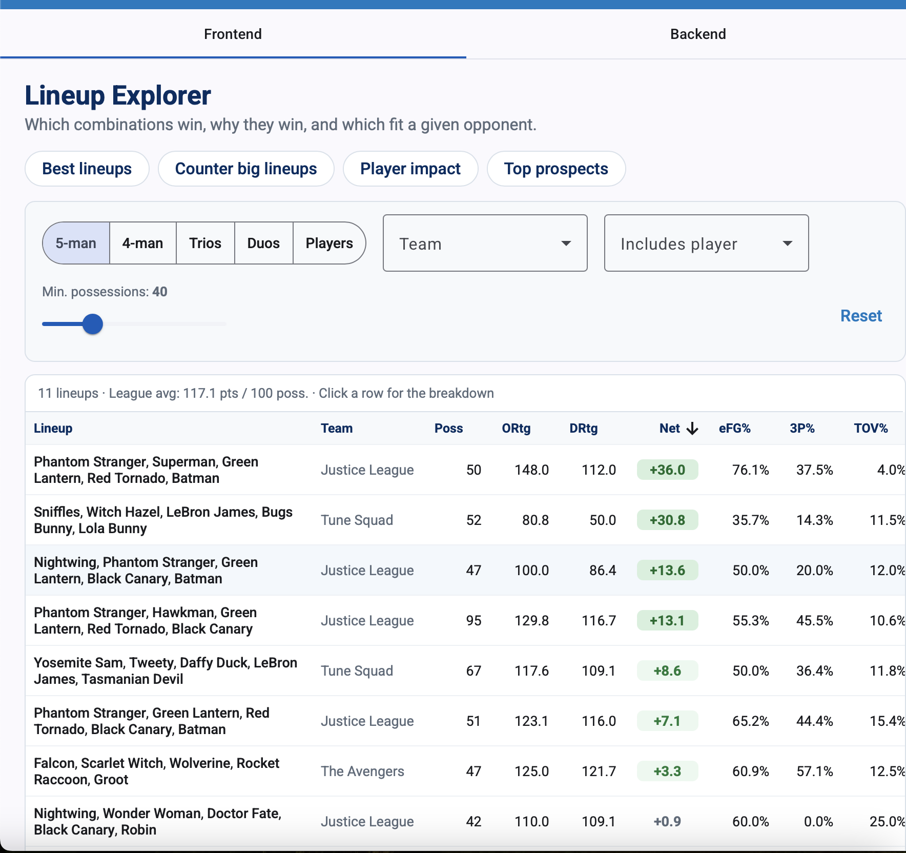
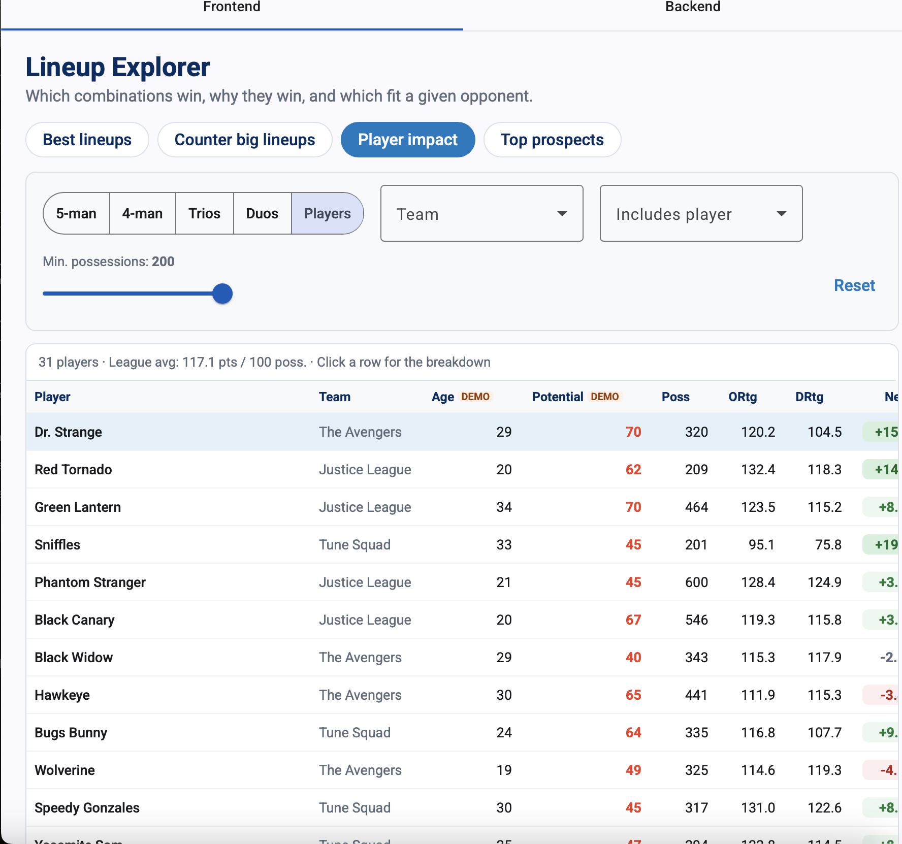
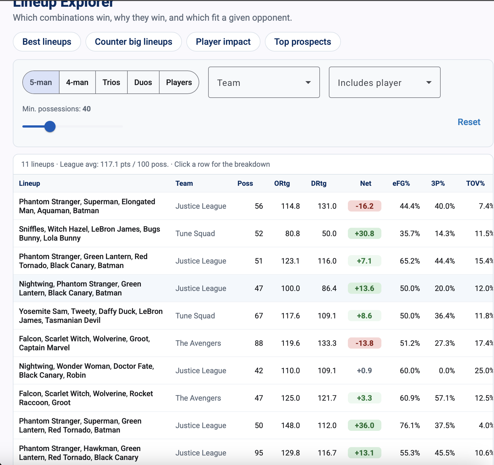
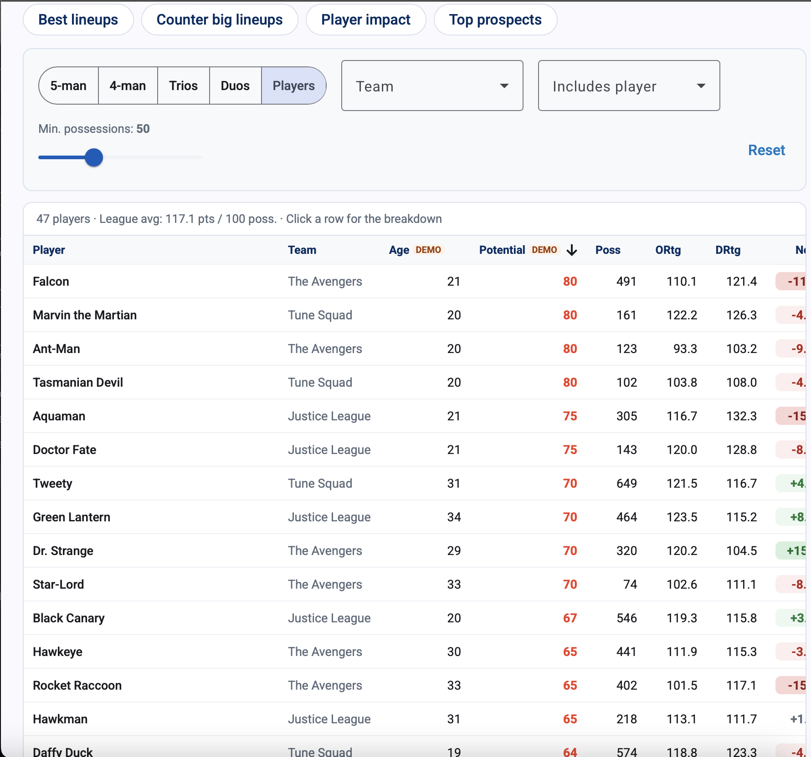
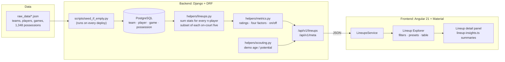

# OKC Lineup Explorer

A lineup analysis tool for coaches and front-office staff: **which combinations win, why they win, and which fit a given opponent.**

**Live app:** https://frontend-production-821f.up.railway.app · **API:** https://backend-production-157c.up.railway.app/api/v1/lineups · **Demo video:** https://youtu.be/kP9bE9MlJZY

Built by Daniel Acevedo Vega for the OKC Thunder 2027 SWE internship technical project. Answers to the data analysis questions are in [`written_responses/responses.md`](written_responses/responses.md).

## Screenshots

| Best lineups (Q1) | Player impact: on/off (Q2) |
|---|---|
|  |  |
| **Counter big lineups (Q3)** | **Top prospects (demo scouting data)** |
|  |  |

## Features

- **One-click views** for the questions a coach actually asks:
  - **Best lineups:** five-man units ranked by net rating.
  - **Counter big lineups:** units that win the rebounding battle on both ends.
  - **Player impact:** players ranked by on/off net rating.
  - **Top prospects:** players ranked by potential grade (demo data, see below).
- **Filters:** lineup size (1–5 players), team, "lineup includes player", and a minimum-possessions slider to hide lineups that barely played. Filters are applied by the API.
- **Sortable table:** offensive, defensive and net rating, eFG%, 3P%, turnover %, offensive/defensive rebound %, opponent 3P%, and total rebound share. Net rating is color-coded.
- **Detail panel:** click any row to see ratings next to league averages, on/off numbers for single players, 3-point shooting on both ends, the Four Factors on each end as bars against a league-average marker, and an automatically generated one-sentence summary. For example: *"Outscores opponents (+36.0 per 100). Takes care of the ball and efficient shooting, but few second chances."*

## Architecture



**How a request flows:**
1. The page turns the current filters into `GET /api/v1/lineups?lineup_size=…&team_id=…&player_id=…&min_possessions=…`.
2. The backend loads all possessions and credits each one to every *n*-player combination of the offensive five (offensive stats) and of the defensive five (defensive stats), grouped by team.
3. It adds derived metrics, applies the filters and returns JSON in the shape of the provided sample, plus the new fields.
4. `/api/v1/meta` returns the teams, players (with demo scouting profiles) and league averages that the filters and comparisons need.

**Deployment (Railway):** three services, **Postgres**, **backend** (gunicorn, root `backend/`) and **frontend** (Express serving the Angular build, root `frontend/`). Both app services deploy automatically from `main`. On every start the backend runs `migrate`, then `seed_if_empty.py`, so a fresh database loads itself and later deploys never duplicate data.

## API

`GET /api/v1/lineups`: one row per lineup. Invalid parameter values fall back to defaults.

| Param | Default | Description |
|---|---|---|
| `lineup_size` | 5 | Players per lineup, 1–5. `1` gives individual player rows. |
| `team_id` | — | Only this team's lineups |
| `player_id` | — | Only lineups that include this player |
| `min_possessions` | 0 | Minimum total (offensive + defensive) possessions |

Each row keeps every field from `sample_summary_data.json` (summed `offensive_*` / `defensive_*` stats, `total_possessions`, FG%/2P%/3P%, `team_id`, `player_ids`, `players`) and adds:

| Field | Meaning |
|---|---|
| `offensive_rating`, `defensive_rating`, `net_rating` | Points scored / allowed per 100 possessions, and the difference |
| `{side}_efg_pct`, `{side}_ts_pct` | Effective FG% (a 3 counts as 1.5 makes) and true shooting % |
| `{side}_tov_pct`, `{side}_ft_rate` | Turnovers per possession, free throws attempted per field goal attempt |
| `{side}_oreb_pct`, `{side}_dreb_pct` | Share of rebound opportunities won by the offense / defense |
| `total_reb_pct` | Share of all rebounds on both ends that this lineup secured |
| `off_court_net_rating`, `on_off_net_rating` | *Single-player rows only.* Team net rating with the player on the bench, and on minus off |

`{side}` is `offensive` (what the lineup did) or `defensive` (what opponents did against it). Percentages are fractions (0–1), matching the sample; a rate with a zero denominator is `0`.

`GET /api/v1/meta` returns `{ teams, players, league_averages }`.

## Design decisions and trade-offs

- **Aggregate in Python, not SQL.** Every possession has to be split into all 1–5 player combinations of each five, which is awkward in SQL and easy in Python. With 1,348 possessions it takes milliseconds, so there are no pre-computed tables to keep in sync. With a full season of data I would pre-compute lineup totals into a table at ingest time and query that instead.
- **Per-100-possession rates as the main metrics.** Raw totals mostly reward playing time. Net rating covers both ends of the floor. On/off net rating is the player version: a player's on-court net rating also reflects his teammates, so it's compared against his own team's net rating without him.
- **Sample size is shown to the user, not hidden.** A lineup that played one possession can have a +300 net rating. The possession count sits next to every rate, the default minimum is 20 possessions, and the footnote explains why.
- **Demo scouting data is labeled as demo.** The dataset has no ages or scouting reports. To show how a potential rating would work, each player gets an age and a 20–80 scout grade, generated from the player's ID so they never change between loads. Potential = grade + 2 per year under 26, capped at 80. Those two inputs are labeled "demo" everywhere they appear and aren't used in the written answers. Only the formula would carry over to real scouting inputs.
- **Production settings come from environment variables.** `DEBUG` and `SECRET_KEY` are read from `DJANGO_DEBUG` / `DJANGO_SECRET_KEY` in production. Local development is unchanged.
- **Left out on purpose:** saved notes/tags need user accounts to be safe on a public URL. Shot charts aren't possible because the data has no shot locations.

## Project structure

```
backend/
  app/helpers/lineups.py        aggregation, filters, team totals, on/off
  app/helpers/metrics.py        pure functions: ratings, four factors, shooting
  app/helpers/scouting.py       demo scouting profiles + potential formula
  app/views/lineups.py          API views and query-param parsing
  app/tests/test_lineups.py     aggregation, API, metrics, scouting and real-data tests
  scripts/ingest_raw_data.py    provided ingest script
  scripts/seed_if_empty.py      loads raw data on deploy if the DB is empty
frontend/src/app/
  lineups-summary/              Lineup Explorer page (filters, presets, table)
  lineup-detail/                detail panel
  _models/lineup.ts             typed API response
  _models/lineup-insights.ts    four-factor config + summary generator (unit tested)
  _services/lineups.service.ts  API client
prompts/ai_prompts.txt          AI prompt log (required disclosure)
written_responses/responses.md  answers to the analysis questions
```

## Running and testing locally

Set up Postgres, the backend and the frontend as described in [Application Setup](#application-setup) below. I used a plain `python3.12 -m venv .venv` in place of pyenv, which the setup allows.

```bash
# backend tests (need the local Postgres running; they build their own test database)
cd backend && ../.venv/bin/python manage.py test app.tests

# frontend unit tests (Vitest)
cd frontend && npm test
```

- **Backend tests (11):**
  - Two hand-built possessions checked by eye.
  - A check that n-player combinations are counted correctly.
  - Filters, API parameter handling, metrics and the potential formula.
  - An integrity test that loads all 1,348 real possessions and confirms each one is counted exactly once for every player combination on the floor.
  - A test that checks Dr. Strange's on/off against numbers calculated by hand from the raw data.
- **Frontend tests (5):** cover the league comparisons and the summary generator.

## What I'd build next

- Head-to-head matchup view: how a lineup performed against specific opponent lineups.
- Confidence ranges on ratings (bootstrapped over possessions), so small samples are visible in the chart, not just a footnote.
- Scouting notes and tags on lineups, behind authentication.
- Pre-computed lineup tables and pagination for a full-season dataset.

## AI usage

AI assistance (Claude Opus 5.5) was used and is disclosed as the assignment requires: every prompt, in order, is in [`prompts/ai_prompts.txt`](prompts/ai_prompts.txt).

---

# Assignment instructions (from the starter repo)

Your work must be your own and original. You may use AI tools to help aid your work if you include a single text file containing an ordered list of any AI prompts, along with the specific model queried (e.g. GPT-5.6 Luna) in the `prompts` directory. Do not include the AI's output.

**Your final submission must include a working backend and frontend, as well as written responses to the questions in part 3. We also require that you deploy your final project and include a screen recording in order for your submission to be considered complete. If you are unable to deploy your application, ensure that your screen recording captures all of the available views and functionality in your frontend.**

### Internship Program Disclosures

* You must be eligible to work in the United States to be able to qualify for this internship.

* The pay for this internship is the greater of your local minimum wage and $13/hour.

* This application is for the purposes of an internship taking place in the Spring, Summer, or Fall of 2027.

### 1. Backend Engineering

* The skeleton API View `LineupsLeagueSummary` can be found in `backend/app/views/lineups.py`. This API View calls the `get_lineup_league_summary_stats` helper function in `backend/app/helpers/lineups.py` to aggregate lineup stats. `LineupsLeagueSummary` accepts a `lineup_size` query param `n` at `/api/v1/lineups` to aggregate n-man lineups across all possessions.

You are to implement the `get_lineup_league_summary_stats` function in `backend/app/helpers/lineups.py`. The goal is to construct a response that includes:
- the players within the lineup (up to 5)
- sum of possession-level stats on both offense & defense

The structure of the response should follow the sample in `backend/app/helpers/sample_summary_data/sample_summary_data.json`.

You are required to add additional metrics to the response to highlight lineup performance and to add features that would address specific use cases when building out the backend. Do not feel limited to solely the `lineup_size` query param.

* Feel free to import additional modules/libraries, but ensure that the `backend/requirements.txt` is updated accordingly. Visiting http://localhost:4200/lineups-summary-api allows you to inspect the response returned by the endpoint while you work on the helper implementation.

### 2. Frontend Engineering

* The `lineups-summary` component, which is viewable at http://localhost:4200/lineups-summary, makes a call to an API endpoint at `/api/v1/lineups` that returns metrics aggregated by lineups (default size is 5-man). Each row corresponds to a given lineup and their associated metrics across all possessions.

* Within the `lineups-summary` component found in `frontend/src/app/lineups-summary/`, create a user interface for NBA coaches and executives that displays the data returned from the API. You should incorporate any additional features you implemented into the backend on the user interface here. We are looking for a thoughtful, creative, and useful interface. 

* Feel free to import additional modules of your choice, and design the interface however you wish. Just make sure that the `package.json` and `package-lock.json` are updated accordingly.

* Upon completion of the Frontend Engineering deliverable, please attempt to deploy your project following the [deployment instructions](#deploying-through-railway) below and upload to this repo screenshots or screen captures that demonstrate your UI.

### 3. Data Analysis

After completing parts 1 and 2, answer the following questions and provide clear explanations of your thought process. We understand that the data provided is limited, and ask that you ignore sample size concerns in your analysis. Include your responses in `written_responses/responses.md`.


1. Which 5-man lineup in the league has the most positive on-court impact?

2. Which player has the most positive on-court impact?

3. A new team is entering the league, and they are known for deploying lineups with multiple centers and large forwards. These lineups are effective at both offensive and defensive rebounding due to their size and emphasis on crashing the glass. Which 5-man lineup is best suited to countering this strategy, and why?


# Application Setup
In order to complete the Backend Engineering or Frontend Engineering deliverables, you will need to do all of the following setup items. Please follow the instructions below, from top to bottom sequentially, to ensure that you are set up to run the app. The app is run on an Angular frontend, Django backend, and a PostgreSQL database.

## Set up database
1. Download and install PostgreSQL from https://www.postgresql.org/download/
2. Ensure PostgreSQL is running, and in a terminal run
    ```
    createuser okcapplicant --createdb;
    createdb okc;
    ```
3. connect to the okc database:
    ```
    psql okc
    ```
4. Grant necessary permissions
    ```
    -- should be in the psql okc terminal with okc=#
    create schema app;
    alter user okcapplicant with password 'thunder';
    grant all on schema app to okcapplicant;
    ```


## Backend

### 1. Install pyenv and virtualenv

Read about pyenv here https://github.com/pyenv/pyenv as well as info on how to install it.
You may also need to install virtualenv in order to complete step 2.

### 2. Installing Prerequisites
The steps below attempt to install Python version 3.12.9 within your pyenv environment. If you computer is unable to install this particular version, you can feel free to use a version that works for you, but note that you may also be required to update existing parts of the codebase to make it compatible with your installed version.
```
cd root/of/project
pyenv install 3.12.9
pyenv virtualenv 3.12.9 okc
pyenv local okc
eval "$(pyenv init -)"
pyenv activate okc
pip install -r backend/requirements.txt
```

### 3. Ingesting the Data
You can setup database tables designed for the data by running the initial migration:
```
cd /path/to/project/backend
python manage.py migrate
```

Then you can ingest the data using the provided script:
```
cd /path/to/project/backend
PYTHONPATH=. python scripts/ingest_raw_data.py
```

### 4. Starting the Backend
Start the backend by running the following commands
```
cd /path/to/project/backend
python manage.py runserver
```

You may ignore the warnings regarding the database not being set such as: `WARNING:root:No DATABASE_URL environment variable set, and so no databases setup`

The backend should run on http://localhost:8000/.


## Frontend

### 1. Installing Prerequisites
Install Node.js (22.x)
```
cd /path/to/project/frontend
npm install
```

### 2. Starting the Frontend
Start the frontend by running the following commands
```
cd /path/to/project/frontend
npm start
```
The frontend should run on http://localhost:4200/. Visit this address to see the app in your browser.

# Deploying through Railway

After you finish the project, we ask that you attempt to deploy your work to make it easily viewable in a browser. Below are instructions on deploying the app through Railway. It should not be necessary to give any credit card information to Railway as the deployment instructions are intended to solely utilize free services on the platform.

### 1. Install the Railway CLI
```
npm i -g @railway/cli
```
### 2. Login to the Railway CLI and create an account through your Github account in your browser
```
railway login
```
### 3. Initialize a Railway Project

Run the command below to create a project (you can use &lt;githubusername&gt;-thunder-2026 for your project name when prompted)
```
railway init
```
After the project is created, you can visit the link generated to view the Project's Architecture and modify the services we will generate in the following steps.

### 4. Add a Postgres instance to your project
Run the command below to add a Postgres instance to your Railway Project's architecture:
```
railway add --database postgres --service database
```

You should now see a "database" block in the Project Architecture interface. If not, you should be able to see it after refreshing the page. **Wait for the Postgres instance to indicate that it has deployed successfully before moving onto the next step. If you get a generic error message when attempting to deploy the database, this may be an intermittent failure that can be resolved by trying again after some time.**

### 5. Add a backend service and connect it to your app's Postgres instance
Run the command below as a single line:
```
railway add \
  --service backend \
  --variables 'DATABASE_URL=${{Postgres.DATABASE_URL}}' \
  --variables 'PGDATABASE=${{Postgres.PGDATABASE}}' \
  --variables 'PGHOST=${{Postgres.PGHOST}}' \
  --variables 'PGPASSWORD=${{Postgres.PGPASSWORD}}' \
  --variables 'PGPORT=${{Postgres.PGPORT}}' \
  --variables 'PGUSER=${{Postgres.PGUSER}}' \
  --variables 'DJANGO_SETTINGS_MODULE=app.settings'
```

You should now see a "backend" block in the Project Architecture interface. If not, you should be able to see it after refreshing the page.

### 6. Configure your backend service
- Select the backend service by clicking on the "backend" block in the Railway Project Architecture interface
- Connect your backend service to your project's Github repository by navigating to Settings and selecting "Connect Repo" in the Source section. From here, select your project's Github repo
- In the same Source section, set the root directory to `backend`
- In the Networking section select "Generate Domain" under Public Networking, and keep the port set as the default (8080)
- Put the same domain generated by the backend in `/path/to/project/frontend/src/environments/environment.prod.ts` **(including the https:// and ignoring the final forward slash / after the domain)** to allow the frontend that you will deploy to get responses from your backend. Make sure you push this change to your main branch

Ex: if the backend domain generated is `backend-thunder-technical.xyz.railway.app`, your `environment.prod.ts` should look like:
```
export const environment = {
  production: true,
  BACKEND_PUBLIC_DOMAIN: 'https://backend-thunder-technical.xyz.railway.app'
};
```

Once you finish configuring your backend service, you can apply the changes by selecting "Deploy" at the top of the interface.

If your backend service isn't able to successfully deploy, try deleting the service by navigating to the bottom of settings, selecting "Delete service", and deploying the destructive changes when prompted. Then try re-doing steps 5 and 6.

### 7. Add a frontend service
Run the command below to add a frontend service. Note: You won't need to add any variables for the frontend service, so you can press enter to skip that portion when prompted.
```
railway add --service frontend
```

You should now see a "frontend" block in the Project Architecture interface. If not, you should be able to see it after refreshing the page.

### 8. Configure your frontend service

- Connect your frontend service to your project's Github repository by clicking the "frontend" block in the Railway Project Architecture interface, navigating to Settings, and selecting "Connect Repo" in the Source section. From here, select your project's Github repo
- In the same Source section, set the root directory to `frontend`
- **Make sure the commit including the change to add your backend service's public domain to `environment.prod.ts` is pushed to your repo**
- In the Networking section select "Generate Domain" under Public Networking, and keep the port set as the default (8080)

Once you finish configuring your frontend service, you can apply the changes by selecting "Deploy" at the top of the interface.

Once deployed, your frontend should be accessible from the domain you generated, and it should be able to access your backend service. **Note down the domain generated for the frontend service in `SUBMISSION.md` as this will be the URL that allows us to access your project.**

### 9. Dump the contents of your local database to the Railway Postgres instance

To export the state of your database, from the root directory of the project, run:
```shell
pg_dump -U okcapplicant okc > dbexport.pgsql
```

Then connect to your Postgres service:
```
cd /path/to/project
railway connect Postgres
```

If prompted to generate SSH keys, follow the instructions to generate one through the CLI and run the command again. You may need to then register the SSH key with Railway after by hitting "Y" in the CLI.

In your railway db psql shell run:
```
-- should be in the psql railway terminal with railway=#
\i dbexport.pgsql
```

# SUBMISSION.md
Please fill out the SUBMISSION.md file to ensure we have your name and email attached to the project along with the frontend public domain URL to access your deployed project.

# Questions?

Email datasolutions@okcthunder.com
